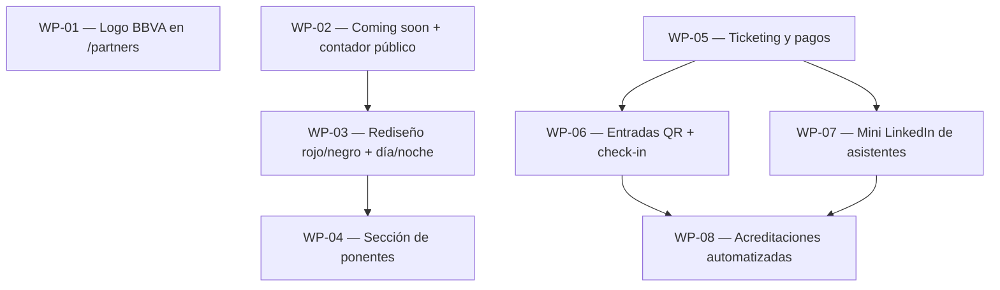

# ROADMAP

> Generado por `generate_map.py`. No editar a mano — regenerar desde el frontmatter de los PRDs.

| ID | Título | Estado | Progreso | Tamaño | Depende de | Camino crítico |
|---|---|---|---|---|---|---|
| WP-01 | Logo BBVA en /partners | specified | 0/3 | XS | — |  |
| WP-02 | Coming soon + contador público | skeleton | 0/4 | S | — |  |
| WP-03 | Rediseño rojo/negro + día/noche | skeleton | 0/6 | M | WP-02 |  |
| WP-04 | Sección de ponentes | skeleton | 0/5 | M | WP-03 |  |
| WP-05 | Ticketing y pagos | skeleton | 0/5 | L | — | sí |
| WP-06 | Entradas QR + check-in | skeleton | 0/4 | M | WP-05 |  |
| WP-07 | Mini LinkedIn de asistentes | skeleton | 0/8 | L | WP-05 | sí |
| WP-08 | Acreditaciones automatizadas | skeleton | 0/4 | M | WP-06, WP-07 | sí |
